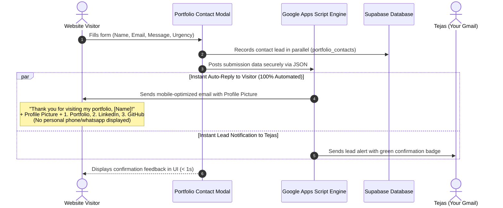

# Instant Contact Form Auto-Responder Setup Guide

This guide explains how your portfolio contact form automatically sends an **instant, warm, and personalized confirmation email** directly to any visitor's Gmail inbox as soon as they submit an inquiry, complete with your **profile picture**, their name, your reassurance that you will reply ASAP, and your **Portfolio** and **Social Links** (LinkedIn & GitHub).

---

## 📱 Mobile-First Email Optimization (Latest Edition)

The email template has been specifically optimized for the **Gmail Mobile App (iOS & Android)**:
1. **Zero Broken Emoji Diamonds**: 100% pure ASCII strings and standard HTML entities (`&rarr;`, `&#9679;`, `&bull;`). No multibyte characters that break into `` question-mark diamonds.
2. **Compact Single-Line Action Buttons**:
   - `1. View Interactive Portfolio →` (Golden signature accent)
   - `2. Connect on LinkedIn →` (Sleek dark card)
   - `3. View Projects on GitHub →` (Sleek dark card)
   - Fits on a single line across all mobile phone screens without awkward text wrapping.
3. **Fluid Layout for Mobile Screens**: Responsive table padding (`10px 6px` outer padding on mobile) so your content has full breathing room and doesn't get squeezed into a narrow vertical column.
4. **Primary Inbox Deliverability**: Uses `GmailApp` with automatic fallback to `MailApp` and clean, spam-free subject lines to ensure delivery straight to the Primary Inbox.

---

## 🌟 Architecture Workflow

---

## 📬 What the Visitor Receives in Their Mobile Gmail

- **Sender**: `Tejas C. Waghmare <tejaswaghmare900@gmail.com>`
- **Subject**: `Thank you for visiting my portfolio, [Name]! - Tejas C. Waghmare`
- **Profile Picture**: Circular portrait with golden glowing border at the top (`76px × 76px`, mobile-optimized).
- **Status Badge**: `● MESSAGE RECEIVED & CONFIRMED`
- **Personalized Greeting**: `Thank you for visiting my portfolio, [Name]!`
- **Warm Reassurance**:
  > *"Hi [Name], thank you so much for visiting my portfolio website and taking the time to reach out! I truly appreciate your message and interest in my work.*
  > 
  > *Personal Confirmation: Your inquiry is safely in my personal inbox. I make it a priority to read every message thoroughly, and I will definitely reply to you as soon as possible."*
- **Copy of Their Inquiry**: Compact recap table of topic, urgency, and their message.
- **Ordered Action Buttons (Single-Line & Tap-Friendly)**:
  - **1. View Interactive Portfolio →** (Electric Yellow `#F5E025`)
  - **2. Connect on LinkedIn →** (Dark card)
  - **3. View Projects on GitHub →** (Dark card)
- **Professional Signature (Strict Privacy Protected)**:
  - Tejas C. Waghmare
  - Microsoft Certified Data Analyst & Business Intelligence Specialist
  - Fabric (DP-600) | Power BI (PL-300) | Azure (DP-700)
  - Location: Pune, Maharashtra, India
  *(⚠️ Tejas's personal phone number, WhatsApp link, and personal contact info are strictly excluded).*

---

## ⚡ How to Update Your Live Google Apps Script in 20 Seconds

1. Open **[https://script.google.com](https://script.google.com)** and open your **Portfolio Auto-Responder** project.
2. Select all in `Code.gs` (`Ctrl + A`) and paste the updated code from **[`google_apps_script_autoresponder.js`](google_apps_script_autoresponder.js)**.
3. Click the **Save** (💾) icon or press `Ctrl + S`.
4. Click the blue **"Deploy"** button (top right) ➔ select **"Manage deployments"**.
5. Click the **Pencil icon** (✏️ Edit) next to your active Web App deployment.
6. In the **Version** dropdown, select **"New version"**.
7. Click **"Deploy"**.

Done! Your live endpoint will now deliver the clean, mobile-optimized email without broken diamonds!
