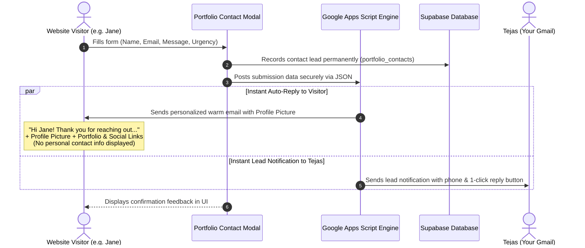

# Instant Contact Form Auto-Responder Setup Guide

This guide explains how your contact form automatically sends an **instant, warm, and personalized confirmation email** directly to any visitor's Gmail as soon as they submit an inquiry, complete with your **profile picture**, their name, your reassurance that you will reply ASAP, and your **Portfolio** and **Social Links** (LinkedIn & GitHub).

---

## 🌟 How It Works

---

## 📬 What the Visitor Receives in Their Gmail

When a visitor (e.g. *Sarah Jenkins*) submits your contact form, she immediately receives an email formatted with your brand colors (Matte Graphite `#15171C` and Electric Yellow `#F5E025`):

- **Profile Picture**: Your circular portrait with an electric yellow glowing border right at the top.
- **Sender**: `Tejas C. Waghmare <tejaswaghmare900@gmail.com>`
- **Subject**: `✨ Thank you for reaching out, Sarah! — Tejas C. Waghmare`
- **Greeting**: `Hi Sarah,`
- **Warm Reassurance**:
  > *"Thank you for taking the time to explore my portfolio and reach out. I truly appreciate your message and interest in collaborating!*
  > 
  > *💬 **Personal Confirmation:** Your inquiry is safely in my personal inbox. I make it a priority to read every message thoroughly, and I will **definitely reply to you as soon as possible**."*
- **Copy of Their Inquiry**: Recap of the topic, urgency, and their exact message quote.
- **Social & Portfolio Links (No personal contact info)**:
  - 🌐 **[Explore My Interactive Portfolio](https://tcwaghmare.github.io/)**
  - 💼 **[Connect with Me on LinkedIn](https://www.linkedin.com/in/tejascwaghmare)**
  - 🐙 **[View My Projects on GitHub](https://github.com/TCWaghmare)**
- **Professional Signature**:
  - Tejas C. Waghmare
  - Microsoft Certified Data Analyst & Business Intelligence Specialist
  - DP-600 | PL-300 | DP-700
  - Pune, Maharashtra, India
  *(⚠️ Note: Your phone number, WhatsApp link, and personal contact info are intentionally excluded from the visitor's email).*

---

## 🔔 What You Receive in Your Gmail

You simultaneously receive an email with:
- **Subject**: `⚡ [Portfolio Lead] A project from Sarah Jenkins (ASAP)`
- Complete visitor phone number, call/WhatsApp permission status, topic, timeline, and message.
- A one-click **"Reply to Sarah"** button that directly opens a draft addressed to Sarah's email.

---

## ⚡ How to Update Your Live Google Apps Script in 15 Seconds

Since you already deployed your script, to apply the latest template with your **profile image** and **updated social links**:

1. Open **[https://script.google.com](https://script.google.com)** and click your **"Tejas Portfolio Auto-Responder"** project.
2. Select all in `Code.gs` and replace it with the updated code from **[`google_apps_script_autoresponder.js`](google_apps_script_autoresponder.js)**.
3. Click the **Save** (💾) icon or press `Ctrl + S`.
4. Click the blue **"Deploy"** button (top right) ➔ select **"Manage deployments"**.
5. Click the **Pencil icon** (✏️ Edit) next to your active deployment.
6. In the **Version** dropdown, choose **"New version"**.
7. Click **"Deploy"**.

Done! Your live Google Apps Script endpoint will now deliver the updated email with your profile picture!
